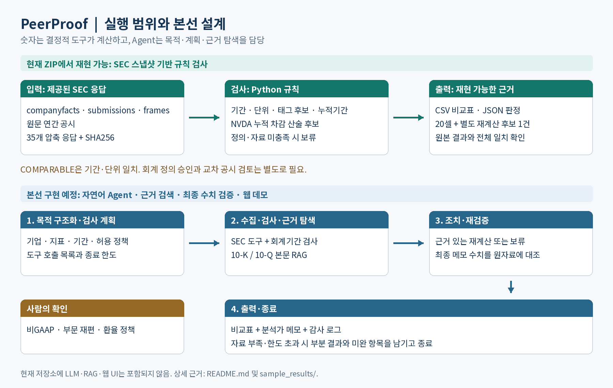

# LikeForLike

**공시 수치의 기간·단위·태그·누적기간을 검사하고, 비교 가능·다시 계산·보류의 근거를 남기는 Peer 비교 검증 Agent의 시작 저장소입니다.**

코드: <https://github.com/minsdevs/likeforlike-agent>

## 구현 상태

| 구분 | 이 ZIP에서 실행 가능 | 본선에서 구현할 내용 |
|---|---|---|
| 데이터 | 제공된 SEC 스냅샷 읽기, 별도 수집 스크립트 | 갱신 정책, 공시 본문 색인 |
| 판정 | 기간·단위 검사, 수동 태그 후보, 누적치 차감, 보류 사유 | 목적별 정책, 의미 검토, 승인된 변환 이력 |
| Agent | 없음. 현재 코드는 Python 규칙 검사기 | 자연어 목적 구조화, 도구 선택, RAG, 제한된 재시도 |
| 출력 | CSV 비교표, JSON 근거·판정, 실행 로그 | 최종 메모 수치 재대조, 웹 화면, 데모 URL |



## 1. 빠른 실행: 네트워크·API 키·모델 없이 재현

요구 환경: **Python 3.10 이상**. 실행 코드는 표준 라이브러리만 사용합니다.

```bash
python3 src/verify_replay.py
```

이 명령은 `data/`의 원본 응답 35개를 SHA256과 바이트 수로 확인한 뒤 스파이크를 실행합니다. `sample_results/original/result.json` 및 `comparison.csv`와 결과 전체를 대조합니다. 결과는 `outputs/replay/`에 생성합니다.

검사기만 실행하려면 다음을 사용합니다.

```bash
python3 src/spike.py
```

기본 출력은 `outputs/latest/result.json`, `comparison.csv`입니다. 터미널에 판정 근거가 출력됩니다. 경로는 선택할 수 있습니다.

```bash
python3 src/spike.py --data-dir data --output-dir outputs/my-run
```

## 2. 이번 제작에서 실제로 확인한 결과

- 기존 수집일: **2026-11-01 UTC**, KST도 같은 날짜. 수집 시각·URL·HTTP 상태·해시는 `data/http_manifest.json`에 있습니다.
- 오프라인 재실행: **2026-11-01 11:22:44 KST**. `sample_results/replay/verification.json`에 UTC 원시각을 함께 남겼습니다.
- 원본 응답 **35개**의 해시·비압축 바이트 수가 모두 일치했습니다.
- `result.json` 전체와 `comparison.csv` **20행**이 제공된 기존 결과와 일치했습니다.
- **실시간 재수집·재실행은 못 했으며, 기존 로그를 첨부했습니다.** 유효 연락처가 포함된 `SEC_USER_AGENT`가 설정되지 않았습니다. 별도 DNS/TLS 연결 검사도 DNS 조회 단계에서 실패했습니다. HTTP 요청은 보내지 않았으며, 이를 SEC 자체 장애로 해석하지 않습니다. 근거: `sample_results/replay/network_check.json`.

오프라인 일치는 기존 계산의 재현성 확인입니다. 최신 공시 재조회, 회계 의미의 정답 확인, 일반적인 탐지 정확도 측정을 뜻하지 않습니다.

## 3. 결과 예시와 판정의 의미

| 사례 | 제공 데이터에서 확인한 사실 | 해석의 한계 |
|---|---|---|
| NVDA 누적 ProductiveAssets 지급 | 6개월 **4,434m** − 1분기 **1,757m** = 2분기 산술 후보 **2,677m USD** | 다른 공시 간 재작성·재분류와 지표 정의 검토 전에는 비교 승인하지 않음 |
| 최신 연간 기간 | NVDA·INTC·QCOM·AVGO는 364일, MU는 371일 | 포함되는 달력 기간도 다름. 일수로 나누어 자동 보정하지 않음 |
| 매출 태그 | NVDA·QCOM은 `Revenues`, INTC·AVGO·MU는 `RevenueFromContractWithCustomerExcludingAssessedTax` | 태그 차이만으로 경제적 정의 차이나 잘못된 공시를 단정하지 않음 |
| EBITDA | 5기업 모두 이 스파이크의 표준 EBITDA 경로에서 보류 | `MAP['EBITDA']`는 빈 목록. 모든 기업별 공시에서 EBITDA가 없다고 검색·입증한 결과가 아님 |

금액 `m`은 백만 달러입니다. NVDA 산술 후보의 기간은 **2026-04-27~2026-07-26**, 원천은 `PaymentsToAcquireProductiveAssets`입니다. 원천 공시 accession은 현재 누적치 `0001045810-26-000075`, 이전 누적치 `0001045810-26-000052`입니다.

원본 그리드는 5기업 × 4지표 = 20셀입니다. 값이 있는 셀은 15개, 값이 없는 EBITDA 셀은 5개입니다. 상태는 **COMPARABLE 2개, HOLD 18개**이며 재계산 후보 1건은 그리드 외 별도 `recalculation` 필드입니다.

- `COMPARABLE`: 기준기업 NVDA와 **기간·단위 메타데이터가 일치**. 회계 정의까지 승인했다는 뜻이 아닙니다.
- `RECALCULATE`: 인접 누적치의 산술 차감 후보. 본선에서는 정의·공시 간 변경 검토 후 채택하거나 보류할 계획입니다.
- `HOLD`: 기간·단위·정의·자료가 정책에 맞지 않거나 충분하지 않음. 누락값을 0으로 채우지 않습니다.

엄격한 정확 날짜 일치 정책으로 보류가 많습니다. 현재 보류 비율을 오류 탐지율이나 업무 완료율로 제시하지 않습니다.

## 4. 실제 자료와 합성 대조군

| 자료 | 유형 | 용도 |
|---|---|---|
| `data/*.json.gz`, `data/*_annual.htm.gz` | 제공된 기존 SEC HTTP200 응답 | 수치·기간·원문 부문 태그 검사 |
| `sample_results/original/` | 제공된 기존 계산 결과·로그의 사본 | 재현성 대조 |
| `sample_results/replay/` | 이번 제작 과정의 오프라인 재실행·검사 기록 | 결과 동일성·환경 상태 증빙 |
| USD 값을 EUR로 바꾼 음성 대조군 | **합성** | 단위 불일치 예시. 5개사 실데이터에서 발견한 환율 오류가 아님 |

수치 재대조 실험(로컬 모델)의 합성 리서치 노트·로컬 모델 실험은 이 최소 저장소에 포함하지 않았습니다. Qwen 실행, RAG, 수치 주장 추출 또는 최종 결과 자체 검증 기능을 이 저장소에서 이미 구현했다고 주장하지 않습니다.

## 5. 라이브 SEC 수집

공식 안내: [SEC API](https://www.sec.gov/search-filings/edgar-application-programming-interfaces), [공정 접근](https://www.sec.gov/search-filings/edgar-search-assistance/accessing-edgar-data).

실제 연락 가능한 이메일을 포함한 User-Agent를 환경변수로 설정합니다. 아래 이메일은 설명용이며 **반드시 본인 연락처로 바꾸어야 합니다**. 스크립트는 `example.com` 예시를 실제 요청에 사용하지 못하게 막습니다.

```bash
export SEC_USER_AGENT='LikeForLike/0.1 contact@example.com'
python3 src/download_data.py
python3 src/spike.py --data-dir data_live --output-dir outputs/live
```

- API 키는 필요하지 않습니다. User-Agent는 식별·연락 목적이며 인증 키가 아닙니다.
- 요청 간 최소 0.6초 간격을 둡니다. SEC의 초당 10회 상한보다 보수적으로 설정했습니다.
- 429와 일시적인 서버 오류는 최대 2회 재시도합니다. 실패를 결과에 기록하고 누락된 수치를 만들지 않습니다.
- 원본 `data/`는 보존합니다. 새 응답은 `data_live/`에 쓰며 기존 파일을 다시 받으려면 `--refresh`를 사용합니다.
- 새 공시·개정치가 추가되면 최신 결과는 제공된 스냅샷과 달라질 수 있습니다. `verify_replay.py`는 제공 스냅샷의 재현성만 검사합니다.
- 연락처는 저장소에 하드코딩하지 않습니다. 새 HTTP manifest에는 실제 User-Agent 연락처를 기록하지 않습니다.

## 6. 코드 보존과 알려진 한계

`src/spike.py`는 제공된 SEC 비교 검증 실험 `spike.py`의 수치 선택·정렬·판정·산술·결과 구조를 유지했습니다. 수정은 명령행 경로, 출력 폴더, 수집일 설명에 한정했습니다. `docs/PROVENANCE.md`와 `sample_results/replay/source_preservation.json`에서 보존 검사를 확인할 수 있습니다.

- 기간 일수는 시작일과 종료일을 모두 포함합니다.
- 최신 연간 공시의 동일 종료일·330~400일 기간을 후보로 고릅니다. 완전한 회계정책 동등성 검사는 아닙니다.
- 태그 후보는 수동 사전입니다. 다른 업종·새 태그·재작성 정책에 일반화됐다는 검증은 없습니다.
- `PaymentsToAcquireProductiveAssets`와 PP&E 지출을 자동으로 같은 CapEx로 합치지 않습니다.
- 누적치 차감은 같은 시작일·같은 태그·인접 종료기간을 사용합니다. 서로 다른 accession 사이의 재분류 검토는 남아 있습니다.
- companyfacts의 표준 법인 전체 fact만으로 부문 재편 연결을 구현하지 않습니다. 원문 부문 axis 9/10은 작은 표본의 존재 확인이며 비교 성공률이 아닙니다.
- 엄격한 날짜 정책을 완화하거나 환율·비GAAP 조정을 적용하려면 근거와 사람의 확인이 필요합니다.
- 현재 코드에는 자연어 Agent·정의 RAG·웹 UI·운영 인증·기업 내부 시스템 연동이 없습니다.

## 7. 본선 개발 계획: 2026-12-03~12-22

| 단계 | 개발 내용 | 확인할 산출물 |
|---|---|---|
| 1주차 | 데이터 도구·판정 엔진 모듈화, API 서버, 출처 스키마 | 고정 스냅샷 재현, 셀별 accession·태그·기간 |
| 2주차 | 목적 해석·도구 계획, 본문 RAG, 최종 수치 재대조, 웹 화면 | 재계산·보류 경로와 한도 내 종료 |
| 3주차 | 고정 평가셋·데모 시나리오, 배포, 실행 문서·발표자료 | 데모 URL·GitHub 코드·발표 PDF |

예정 Agent는 수집·검사·근거 탐색·재검증을 제한된 횟수로 수행합니다. 필수 자료가 없거나 도구 호출 한도를 넘으면 부분 결과와 미완 목록을 남기고 종료합니다. 비GAAP 재조정·부문 재편 연결·환율 정책은 사람에게 확인받는 범위입니다. FRED 데이터는 이 저장소에서 사용·저장하지 않습니다.

## 8. 출처·권리·보안

이 프로젝트의 코드·문서는 MIT입니다. SEC 원자료와 제3자 자원에 MIT를 덮어씌우지 않습니다. SEC 데이터의 접근·재사용 안내와 각 자원의 조건은 [출처 기록](docs/PROVENANCE.md)에 적었습니다.

지원자 이름이 들어 있던 원본 HTTP manifest의 User-Agent 필드만 가렸습니다. 원본 SEC 응답·계산 결과·수집 로그의 수치와 해시는 변경하지 않았습니다. 공개 공시 원문에는 공개된 기업·임원 정보가 포함될 수 있습니다. 지원자의 사적 개인정보·계정 토큰·API 비밀키·개인 절대경로는 저장하지 않습니다.
